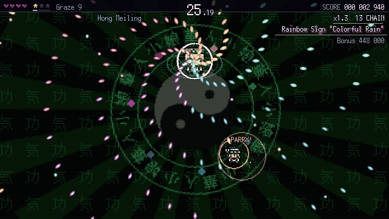
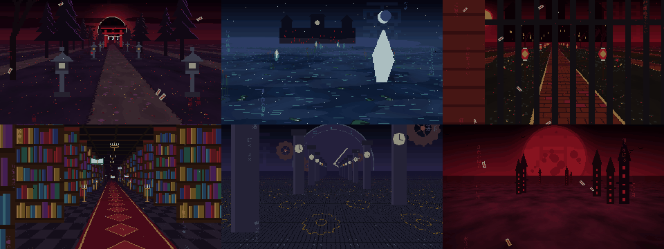
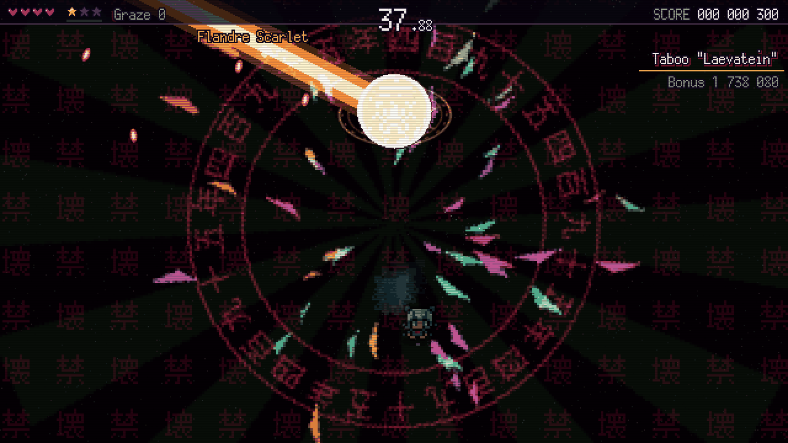
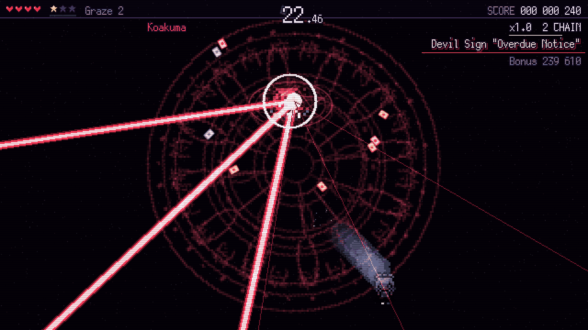
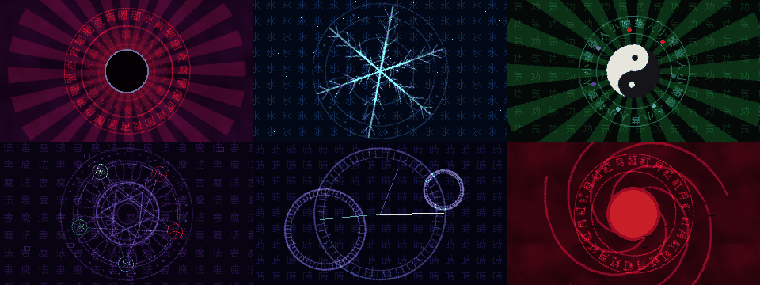
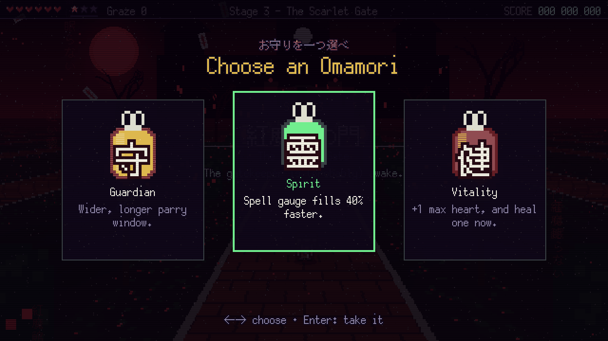
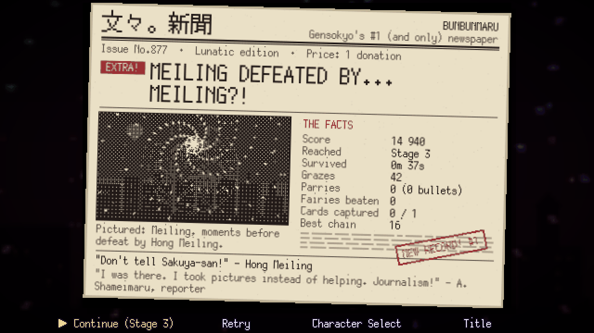
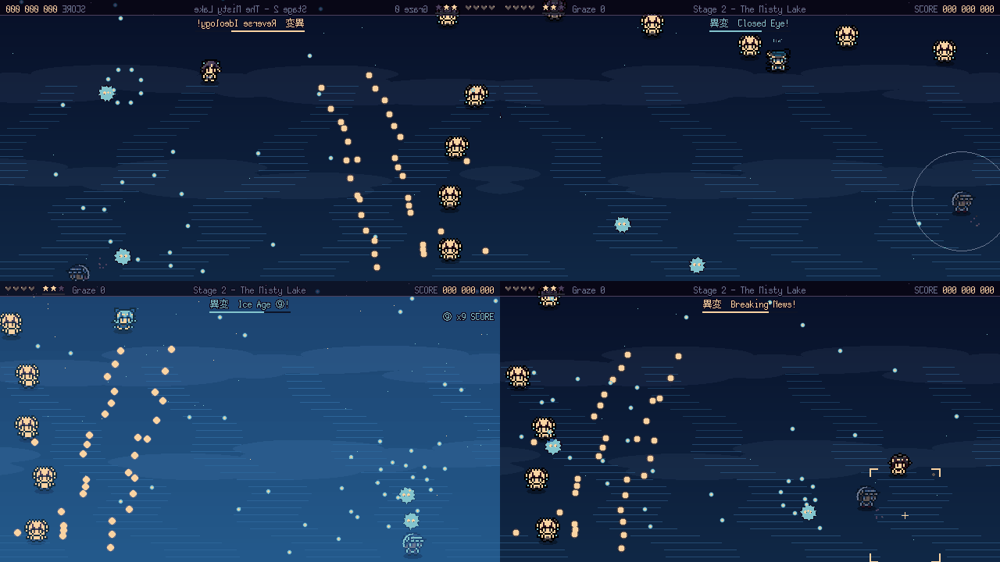
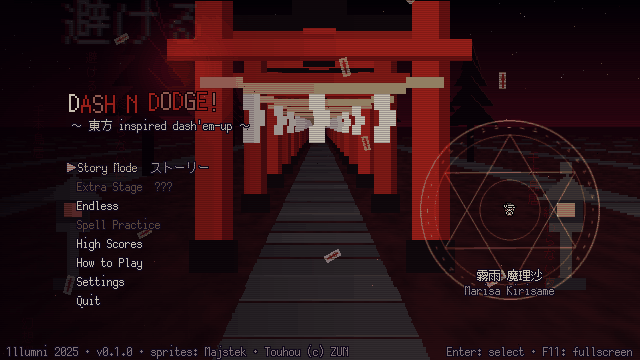

# 避ける — Dash N Dodge!

> **v0.1.0**: a Touhou-inspired arena danmaku game. Dash through bullet walls, parry them back,
> graze for points and survive the Scarlet Mist incident.



## What's new in 0.1.0

A full remake of the 0.0.4 prototype:

- **Pseudo-3D stage backgrounds**, Touhou style: the camera flies over perspective floors while torii gates, stone lanterns, bookshelves, gears and gothic spires rush past. The look is dark and ritualistic: eclipsed black suns, vertical kanji columns, falling talismans, glitch tears and chromatic aberration.
- **A unique spell card background for every boss**: rotating mandalas, kanji rings, clockwork, vortexes.
- **Boss intro cards**, midbosses, and lasers you have to dash through.
- **Omamori charms**: after each stage, pick one of three lucky charms that change your run (12 to collect).
- **Animated sprites**: the 16×16 Majstek sprites now bob, lean into movement, squash and stretch on dashes, flash white when hit, leave afterimages and cast shadows. Bosses get rotating magic circles and an HP ring.
- **Real danmaku**: 14 bullet types (orbs, rice, knives, amulets, ice, stars, butterflies, spears…) with glow, spawn flashes and up to hundreds of bullets on screen at 60 FPS.
- **A story mode**: 6 stages modelled on *Embodiment of Scarlet Devil* (Rumia → Cirno → Meiling → Patchouli → Sakuya → Remilia) plus an Extra stage (Flandre), with 4 midbosses (Daiyousei, Koakuma, Sakuya, Patchouli). That's **25 spell cards**, pre-boss banter and endings for each character.
- **6 playable characters**, each with a unique spell card (bomb) and passive.
- **Incidents (異変)**: chaotic mid-stage events. Seija flips the screen, Suika gets everyone drunk, Koishi makes bullets invisible, Yuyuko eats your items, Tewi hands out fake hearts…
- **Game over screen**: Aya prints your defeat on the front page of the *Bunbunmaru Newspaper*, complete with a dithered photo of your last moment.
- **More modes**: Endless, Spell Practice, high score tables, continues, a tutorial, gamepad support.
- Pixel-perfect 640×360 rendering scaled to any window, procedural parallax backgrounds, synthesized retro sound effects.



| | |
|---|---|
|  |  |
|  |  |
|  |  |
|  | |

## Running the game

**From source** (Python 3.10+):

```bash
python -m venv .venv
.venv/bin/pip install -r requirements.txt      # Windows: .venv\Scripts\pip ...
.venv/bin/python main.py
```

**Standalone executable**: `pip install -r requirements-dev.txt`, then `python build.py`. The result lands in `dist/`.

**Tests**: `.venv/bin/python -m pytest tests` (GPU tests are skipped when no OpenGL context is available).
PyInstaller can only build for the OS it runs on, so build the Windows `.exe` from Windows.

Settings, high scores and unlocks are saved in `~/.local/share/dashndodge/save.json`
(Windows: `%APPDATA%\DashNDodge\save.json`).

## Controls

| Action | Keyboard | Gamepad |
|---|---|---|
| Move | Arrows · WASD · ZQSD | Left stick / D-pad |
| Focus (slow + show hitbox) | Shift (hold) | LB / RB |
| Dash | Space · K · C | A |
| Parry | F · J · V | B / X |
| Spell card (bomb) | X · L · E | Y |
| Pause | Esc · P | Start |
| Fullscreen | F11 · Alt+Enter | |
| Skip dialogue | hold Shift | |

## How it plays

- **Dash**: a quick burst with invincibility frames. Dash *through* bullet walls, and smash fairies on contact. Bullets grazed mid-dash count double.
- **Parry**: press it as bullets reach you and every bullet inside the ring flies back at the nearest enemy. It's the main way to break boss spell cards early. Whiff it and it goes on cooldown.
- **Graze**: brush past bullets without getting hit. Grazes give points, build the **chain** multiplier (up to ×5) and charge the **spell gauge** (the stars).
- **Spell cards**: one full star = one bomb, a screen-clearing super move. Casting it within a few frames of getting hit cancels the hit (**deathbomb**).
- **Your hitbox is the tiny dot**, not the sprite. Hold Focus to see it.
- **Boss spell cards**: survive until the timer ends, or break them with parries, dash strikes and spells. Capture one without getting hit or bombing to earn its bonus.
- **Lasers** flash a thin warning line first. They can't be parried: step aside or dash through them.
- **Omamori charms**: after each stage (and at the start of the Extra stage, and after each Endless boss) you pick one of three charms: more hearts, faster dashes, a wider parry, slower bullets while focusing, and more. Your charms are kept when you Continue.

### Characters

| Character | Spell card | Passive |
|---|---|---|
| Reimu Hakurei | Fantasy Seal: 7 homing orbs | Bigger graze zone |
| Marisa Kirisame | Master Spark: a huge tracking laser | Faster, longer item magnet |
| Sakuya Izayoi | The World: stops time, plants knives | 2 dash charges |
| Hong Meiling | Taikyoku Shockwave: reflects every bullet it touches | 6 hearts, wider parry. Naps when idle. |
| Cirno | Perfect Freeze: freezes everything, then shatters it | Every 9th graze pays ⑨×. Big hitbox. |
| Remilia Scarlet *(unlock)* | Spear the Gungnir: three piercing spears | Every 20 kills heal a heart |

### Modes

- **Story**: 6 stages, Easy → Lunatic. Clearing it unlocks Remilia and the Extra stage.
- **Extra Stage**: the forbidden basement. Four of a Kind, Cranberry Trap, QED…
- **Endless**: waves forever, random incidents and random boss cards, getting faster over time.
- **Spell Practice**: replay any spell card you've already seen (midbosses included), and track your captures.

Settings let you tune music/SFX volume, fullscreen, screen shake, background brightness (lower it if bullets get hard to read), the renderer, bloom, dynamic lighting, a CRT screen curve, visual effects (glitch, grain, aberration) and scanlines.

## Graphics

The game is drawn on a 640×360 canvas, then finished on the GPU with OpenGL shaders (`moderngl`):

- **Bloom** on bullets, lasers and magic, plus a soft shoulder so bright spots glow instead of clipping.
- **Dynamic 2D lighting**: bullets, characters, bosses, spells, stone lanterns and crystals light up the stage around them.
- **God rays** pouring out of each stage's sun or moon (and out of the boss during spell cards), occluded by torii, mansions and spires.
- **Shockwave refraction**, a zoom-blur **impact punch** on hits, parries, bombs and boss kills, heat haze in the basement, and a red pulse when you are down to your last heart.
- **Colour grading** per stage, pushed harder during spell cards; vignette, film grain, pixel-aligned scanlines and an optional CRT curve.
- **Sharp-bilinear upscaling**: crisp pixels at any window size, letterboxed, with sub-pixel screen shake.
- Scene changes **burn away** in a diagonal dissolve; menus have a sliding, glowing selection bar, and the title screen opens with an animated logo.

If OpenGL is not available, the game falls back to the classic renderer automatically (Settings → Renderer switches between the two).

## Custom music

Drop `.mp3` / `.ogg` / `.wav` files into `vfx/musics/`. The game picks them by file-name prefix:

| Prefix | Plays during |
|---|---|
| `title` | title screen |
| `stage1` … `stage6`, `extra`, `endless` | that stage |
| `boss_rumia`, `boss_cirno`, …, `boss_flandre`, or just `boss` | boss fights |
| `ending` | ending / credits |

Anything without one of these prefixes is the default track. Right now *Dance Dance Little Flowers !* is the only track, so it plays everywhere.

## Project layout

```
main.py              entry point
build.py             PyInstaller build script
dashndodge/
  app.py             window, fixed 60 Hz loop, scene stack
  game.py            gameplay scene (collisions, scoring, flow)
  player.py          movement, focus, dash, parry
  characters.py      playable characters + their spell cards
  bullets.py         bullet art, movement, collision
  enemies.py         fairies, kedama, behaviour scripts
  boss.py            boss entity and spell card flow
  bossdefs.py        the bosses, midbosses and their 25 spell cards
  stages.py          stage scripts, endless director, practice
  incidents.py       the 9 incidents
  backgrounds.py     the pseudo-3D stage scenes
  render3d.py        mode-7 style planes + projected props
  textures.py        procedural floor textures and props
  spellbg.py         per-boss spell card backgrounds
  post.py            CPU effects: glitch tears (+ grain/scanlines/aberration on the classic renderer)
  renderer.py        GPU pipeline (moderngl): bloom, god rays, lighting, grading, upscaling
  shaders.py         the GLSL shaders
  screenfx.py        per-frame screen effect state + light map, fed by the scenes
  gamefx.py          turns gameplay state into lights, grade and ripples
  charms.py          omamori charms
  gfx.py / fx.py     sprite animation, magic circles, particles
  ui.py              HUD, dialogue, cut-ins
  synth.py / audio.py  synthesized SFX and music
  scenes/            title, character select, pause, results, ...
```

Patterns and stages are plain Python generators (`yield n` waits *n* frames), so adding a spell card is just a function in `bossdefs.py`.

## Credits

- Original game & remake: **1llumni**
- Character sprites: **Majstek**, *Touhou Mini 16x16 Pack* (non-commercial use, credit required)
- Music: *Dance Dance Little Flowers !*
- Font: PixelMplus
- Touhou Project © ZUN / Team Shanghai Alice. This is a non-commercial fan game made under the
  [Touhou Project fan creation guidelines](https://touhou-project.news/guidelines_en/). It contains no assets taken from the official games.
